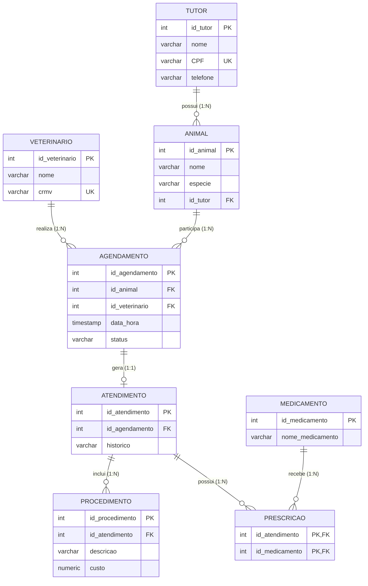

# 🐾 Sistema de Gestão de Clínica Veterinária

Projeto de modelagem conceitual, lógica e implementação física de um banco de dados relacional voltado para a gestão de uma Clínica Veterinária.

Desenvolvido para a disciplina de **Banco de Dados** do curso de **Engenharia de Computação** da **Universidade Federal de Uberlândia (UFU)**.

---

## 👩‍💻 Autoria e Contexto Acadêmico

- **Instituição:** Universidade Federal de Uberlândia (UFU)
- **Faculdade:** Faculdade de Engenharia Elétrica (FEELT)
- **Curso:** Engenharia de Computação
- **Disciplina:** Banco de Dados (2º Semestre de 2026)
- **Professor:** Marcio José da Cunha
- **Aluna:** Ana Flávia de Oliveira


---

## 📋 Descrição do Sistema

O sistema visa gerenciar os processos operacionais de uma clínica veterinária, permitindo:
1. **Cadastro de Tutores:** Registro dos responsáveis pelos animais (nome, CPF, telefone).
2. **Cadastro de Animais:** Vínculo de cada pet ao seu respectivo tutor, com dados de espécie e identificação.
3. **Corpo Clínico (Veterinários):** Controle dos médicos veterinários atuantes e seus respectivos registros no CRMV.
4. **Agendamento de Consultas:** Agendamento de atendimentos com data/hora e controle de status (`agendado`, `realizado`, `cancelado`).
5. **Histórico de Atendimentos:** Registro descritivo detalhado do histórico clínico de cada consulta realizada.
6. **Procedimentos:** Registro de procedimentos efetuados em cada atendimento, incluindo descrição e custos.
7. **Medicamentos e Prescrições:** Catálogo de medicamentos e registro associativo das prescrições emitidas em cada consulta.

---

## 📐 Diagrama Entidade-Relacionamento (ER)



---

## 🧠 Modelo Lógico e Normalização

O esquema relacional foi projetado em conformidade com as regras da **3ª Forma Normal (3FN)**:

- **1ª Forma Normal (1FN):** Todos os atributos são atômicos e indivisíveis. Não existem atributos multivalorados; medicamentos prescritos e procedimentos foram decompostos em tabelas específicas vinculadas ao atendimento.
- **2ª Forma Normal (2FN):** Não existem dependências parciais; todos os atributos não-chave dependem da totalidade da chave primária (ex.: histórico clínico depende exclusivamente de `id_atendimento`).
- **3ª Forma Normal (3FN):** Não existem dependências transitivas entre atributos não-chave. As informações do tutor pertencem exclusivamente à entidade `Tutor`, sendo referenciadas em `Animal` apenas pela chave estrangeira `id_tutor`.

---

## 💾 Modelo Físico

A implementação física utilizou tipos padronizados e restrições de integridade estritas:
- **Chaves Primárias e Estrangeiras:** Tipo `INTEGER` com integridade referencial via `FOREIGN KEY`.
- **Textos e Nomes:** `VARCHAR` dimensionados para otimizar espaço (`VARCHAR(100)`, `VARCHAR(255)`, etc.).
- **Datas e Horários:** `TIMESTAMP`.
- **Valores Monetários:** `NUMERIC(7,2)`.
- **Restrições:**
  - `NOT NULL` (ex.: `nn_tutor_name`, `nn_vet_nome`, etc.).
  - `UNIQUE` (ex.: `un_tutor_cpf`, `un_vet_crmv`).
  - `CHECK` (ex.: `chk_status CHECK (status IN ('agendado', 'realizado', 'cancelado'))`).

---

## 📁 Estrutura do Repositório

```text
├── Criacao_tabelas.sql                      # Script DDL com a criação das tabelas e constraints
├── Populando_tabelas_-_Insercao_de_dados.sql # Script DML com dados de teste, tabela Prescricao e consultas
├── Diagrama_Clinica_Veterinaria.drawio.html # Diagrama conceitual/lógico exportado pelo Draw.io
├── Relatorio_Clinica_Veterinaria.pdf        # Relatório técnico completo do trabalho
├── .gitignore                              # Arquivos e extensões ignorados pelo Git
└── README.md                               # Documentação do projeto
```

---

## 🚀 Como Executar os Scripts

Você pode executar os scripts em qualquer SGBD compatível com SQL padrão (como **PostgreSQL**, **MySQL** ou **SQL Server**):

1. **Criação do Banco e Tabelas:**
   Execute o script `Criacao_tabelas.sql` para criar a estrutura relacional com as devidas constraints.

2. **Carga Inicial e Testes:**
   Execute o script `Populando_tabelas_-_Insercao_de_dados.sql` para:
   - Inserir registros em Tutores, Veterinários, Animais, Medicamentos e Agendamentos.
   - Criar e popular a tabela associativa `Prescricao`.
   - Executar consultas (`SELECT` com `JOIN`) para testar o relacionamento entre clientes, animais, consultas e prescrições.
